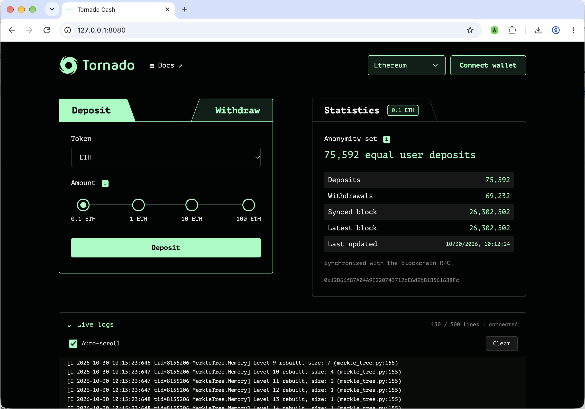
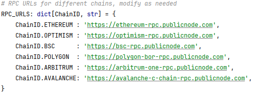
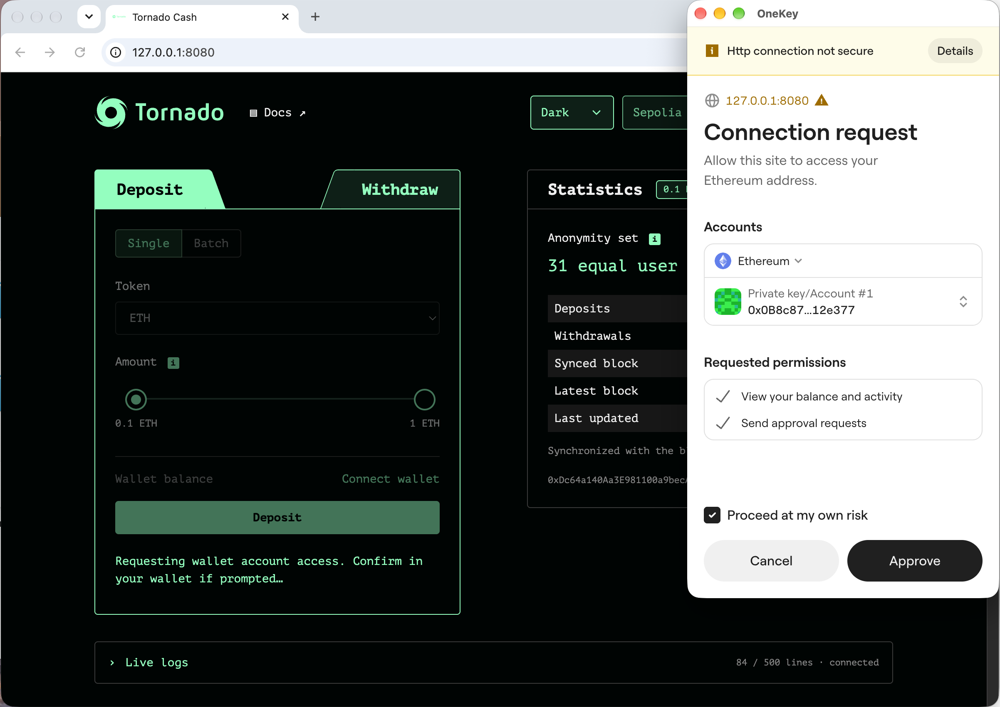
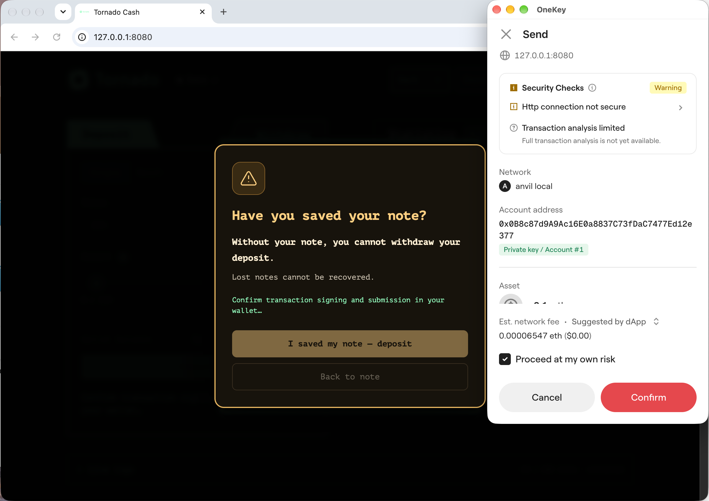
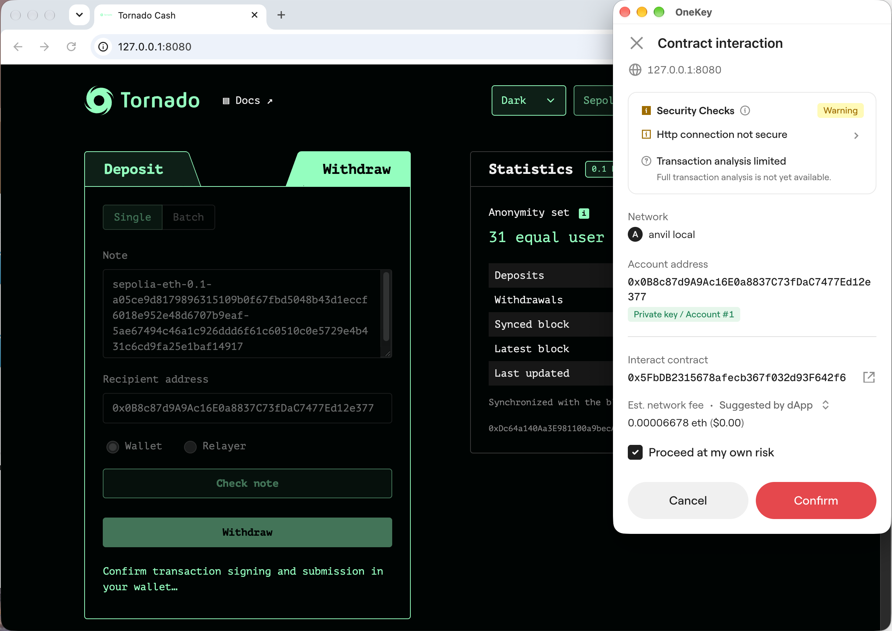
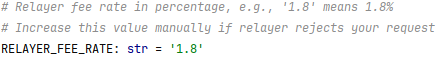

[](LICENSE)
[](https://github.com/ge0rgegarcia/tornadocash-redux#readme)
[](https://github.com/ge0rgegarcia/tornadocash-redux/stargazers)
[](https://github.com/ge0rgegarcia/tornadocash-redux/issues)
[](https://github.com/ge0rgegarcia/tornadocash-redux/actions/workflows/python-app.yml)


*__Security Warnings__*  
* *Only run the __AUDITED__ open source code and scripts locally or binaries compiled on your machine*  
* *Do not trust or use __ANY__ Tornado Cash service from the webpage or IPFS*  
* *There’s no longer any such thing as an "official website" after the sanctions*  
* *Any websites that claim themselves as "official" are 100% __FAKE__*  
* *See 👉 [[Block Domain] Fake ethereum Tornado cash websites Phishing](https://github.com/MetaMask/eth-phishing-detect/issues/13826)*


*__Compliance Statement__*  
*This project provides open-source client software to interact with on-chain smart contracts.*  
*It does not custody funds, relay transactions for others, run a mixing service, or charge fees.*  
*The code is offered as-is for educational and interoperability purposes only.*  
*By using this software, you are solely responsible for how you use it. You must:*  

* *Comply with all applicable laws and regulations in your jurisdiction (e.g., AML/CFT, sanctions/export controls).*
* *Avoid interacting with sanctioned persons, entities, or addresses, and perform your own due diligence.*
* *Use at your own risk; no warranties or guarantees are provided.*  

*Nothing here constitutes legal advice. If you are unsure about your obligations, consult qualified counsel before using this software.*  


# Tornado Cash Redux



A Python implementation to interact with Tornado Cash smart contracts.  

Similar to the original [tornado-cli](https://github.com/tornadocash/tornado-cli), but more features and better experience


- [Preparations](#preparations)
  - [Download Code](#download-code)
  - [Download Database](#download-database)
  - [Sync Blockchain](#sync-blockchain)
  - [RPC Service (Optional)](#rpc-service-optional)
  - [Zero-knowledge proof runtime (Optional)](#zero-knowledge-proof-runtime-optional)
- [Running Unittests](#running-unittests)
- [Functionality Testing](#functionality-testing)
- [WebUI](#webui)
- [CLI Usage & Tutorial](#cli-usage--tutorial)
  - [Deposit](#deposit)
  - [Batch Deposit](#batch-deposit)
  - [Offline Deposit](#offline-deposit)
  - [Withdraw](#withdraw)
  - [Batch Withdraw](#batch-withdraw)
  - [Query Deposit Age](#query-deposit-age)
- [Known Relayers](#known-relayers)
- [Supported Deployments](#supported-deployments)


## Preparations

### Download Code

Requires Python `3.10+`; Python `3.14` is recommended.  

Clone this repository and install dependencies    
    
```bash
git clone https://github.com/ge0rgegarcia/tornadocash-redux.git
cd tornadocash-redux
pip install -r requirements.txt
```
  
### Download Database
According to the Tornado Cash protocol, to initiate a withdrawal, the user is required to rebuild the merkle tree with the contract's **ALL** historical commitments to calculate the latest tree root, which means we have to save a copy of all contract events locally.  

Download the database cache for the first startup to accelerate this process.  
Put all `.sqlite` files under the `./db` directory.    

```bash
# Under the tornadocash-redux root directory
cd db
git clone https://github.com/ge0rgegarcia/tornadocash-db.git cache
mv cache/*.sqlite .
rm -rf cache
```

### Sync Blockchain

The downloaded database has about 1~15 days delay, to make sure the data is up-to-date, please sync the blockchain data before the first use.  
`python cli.py --sync <chain> <symbol> <unit>`  

Or, sync all deployments:  
`python cli.py --sync_all`    

It is recommended to keep the program running to stay synchronized with the blockchain, simply add a `--keep` option to `--sync` or `--sync_all` command.  

### RPC Service (Optional)

Configure RPC endpoints in `RPC_URLS` in `config.py`.




### Zero-knowledge proof runtime (Optional)

Select the Groth16 backend in `config.py`:

```python
ZK_BACKEND: str = 'python'  # Values: 'python', 'javascript'
ZK_WORKERS: int = 8         # Values: 1 to 8
```

The Python backend is the default and does not require Node.js.
The legacy JavaScript backend remains available for compatibility checks and requires `node` on `PATH`.

Using Python 3.14.7 and Node.js 26.7.0, the median proof-generation time over five runs with the same input was:

| Backend    | Median  |
|------------|---------|
| Python     | 1.061 s |
| JavaScript | 1.791 s |

The Python backend was 40.8% faster in this benchmark. Results vary by hardware and runtime version.
See [`zk/groth16/README.md`](zk/groth16/README.md) for implementation and artifact verification details.


## Running Unittests

It is **HIGHLY** recommended to run all unit tests before using this program, to make sure the mathematics and cryptographic calculations are correct on your machine.  
```bash
python -m unittest discover -s test -p "test_*.py"
# Or
pytest -q
```


## Functionality Testing
To test the deposit and withdrawal functionalities, you can use the Ethereum Sepolia testnet to try it out.  
Sepolia ETH faucets:

Alchemy 👉 [https://www.alchemy.com/faucets/ethereum-sepolia](https://www.alchemy.com/faucets/ethereum-sepolia)    
Chainlink 👉 [https://faucets.chain.link/sepolia](https://faucets.chain.link/sepolia)  
Google 👉 [https://cloud.google.com/application/web3/faucet/ethereum/sepolia](https://cloud.google.com/application/web3/faucet/ethereum/sepolia)    
QuickNode 👉 [https://faucet.quicknode.com/ethereum/sepolia](https://faucet.quicknode.com/ethereum/sepolia)  

Sepolia DAI can be minted from the [Aave Faucet contract on Etherscan](https://sepolia.etherscan.io/address/0xC959483DBa39aa9E78757139af0e9a2EDEb3f42D#writeContract).

1. Open `Contract → Write Contract → Connect to Web3`
2. Expand `mint` and enter the following values.

| Parameter | Value                                               |
|-----------|-----------------------------------------------------|
| `token` | `0xFF34B3d4Aee8ddCd6F9AFFFB6Fe49bD371b8a357`        |
| `to` | Your wallet address                                 |
| `amount` | `10000000000000000000000` (10,000 DAI, 18 decimals) |

3. Click **Write** and confirm the transaction in your wallet. You need a small amount of Sepolia ETH for gas.


## WebUI

<p align="center">
  
  
  
</p>

Configure networks and ports with `WEBUI_*` in `config.py` then start the local WebUI:  

```bash
python webui.py
```

Connect through a browser wallet or **WalletConnect**. For WalletConnect, set `WEBUI_WALLETCONNECT_PROJECT_ID` in `config.py`.  

Back up your note before depositing and keep it private. ERC20 deposits may require a separate approval transaction.  

**Local use only:** keep `WEBUI_HOST = '127.0.0.1'`. Do not expose the service to a LAN or the public Internet.  


## CLI Usage & Tutorial

The CLI examples below use synthetic notes, keys, and transaction hashes. Example log times use Madrid local time.

### Deposit

The private key is used to provide ETHs for deposit and pay for gas fees, make sure it has enough balance.
```bash
# python cli.py --deposit <key> <chain> <symbol> <unit>
# <key>   : Private key to provide ETHs for deposit and pay the gas fee, hex string, '0x' prefix is optional
# <chain> : Name of the chain, values: ethereum, optimism, bsc, polygon, arbitrum, avalanche, sepolia. Case insensitive
# <symbol>: Name of the token, values: eth, bnb, pol, avax, dai, cdai, usdt, usdc, wbtc. Case insensitive
# <unit>  : Tornado unit of coins, eg: 0.1, 1, 10, ...

> python cli.py --deposit 0xb4eee619500e058e19d85faa4efd3d68df0f93bc2551267aa88a947fd3d698f5 sepolia eth 0.1
```

If succeeded, you will see logs like below, and the generated note will be printed to the console and saved to a backup file under the `./backup` directory.  
The `note` has full access to the deposited funds, please keep it private and secure.
```log
[I 2026-11-13 19:20:21:477 tid=43284 cli] Depositing Sepolia 0.1 eth (cli.py:357)
[I 2026-11-13 19:20:21:570 tid=43284 cli] IMPORTANT: Please save the note text below and keep it private (cli.py:377)
[I 2026-11-13 19:20:21:570 tid=43284 cli] IMPORTANT: sepolia-eth-0.1-1141d3df38392f88e244fb4afe2fe00a1e093407a0a9b47bb9c596f24b7c77-409b0a7ae893311f7d02dbff4ed717fbc628419b797b25a5f9560d1bfe9c1b (cli.py:378)
[I 2026-11-13 19:20:26:970 tid=43284 Tornado] deposit(from=0x37F449B4C5275C19BB1D95F07C5b7dF2503FABeB) succeed, tx hash: c4def9b58c8a06a8748af7437ac1666853eb52b716adffcc517c8b4d5ade6530 (core.py:271)
[I 2026-11-13 19:20:26:971 tid=43284 cli] IMPORTANT: Note backup saved to ./backup/2026-11-13_19.20.21.570_sepolia_eth_0.1.txt (cli.py:388)
```

### Batch Deposit

Deposits on the same chain are combined into one transaction, including native and ERC20 tokens. Each chain uses a separate transaction.
For an ERC20 batch, deploy [BatchDepositorERC20](contracts/BatchDepositorERC20.sol) or [BatchDepositorUniversal](contracts/BatchDepositorUniversal.sol) according to the tokens in the batch, approve each token to its deployed address, then call it to make all deposits.
The Python client compiles the contracts with native `solc 0.8.30` on first use, downloading it if needed, and caches the bytecode locally. Node.js is not required.
The deployment sends no native tokens. Native tokens in a mixed batch are sent with the final deposit call. All notes are backed up before submission.

```bash
# python cli.py --deposit_batch <key> <json>
# <key> : Private key to provide ETHs for deposit and pay the gas fee, hex string, '0x' prefix is optional
# <json>: JSON string describing the batch, eg:
#         {"ethereum": {"eth": {"10": 100, "100": 20}}, "polygon": {"pol": {"100000": 1000}}}

> python cli.py --deposit_batch 0xb4eee619500e058e19d85faa4efd3d68df0f93bc2551267aa88a947fd3d698f5 "{'sepolia':{'eth':{'0.1':3}}}"
```


### Offline Deposit

Create a note on the offline machine, scan the QR code or copy the invoice text to the online machine  
```bash
# python cli.py --create_note <chain> <symbol> <unit>
# <chain> : Name of the chain, values: ethereum, optimism, bsc, polygon, arbitrum, avalanche, sepolia. Case insensitive
# <symbol>: Name of the token, values: eth, bnb, pol, avax, dai, cdai, usdt, usdc, wbtc. Case insensitive
# <unit>  : Tornado unit of coins, eg: 0.1, 1, 10, ...

> python cli.py --create_note sepolia eth 0.1
[I 2026-11-13 19:05:45:111 tid=39724 stdout]  ▄▄▄▄▄▄▄  ▄▄▄ ▄▄▄▄▄ ▄ ▄▄▄▄▄▄   ▄▄▄▄▄▄▄ 
[I 2026-11-13 19:05:45:111 tid=39724 stdout]  █ ▄▄▄ █ ▄▄█   ▀▀█ █ ▀▄▀ █ ██▄ █ ▄▄▄ █ 
[I 2026-11-13 19:05:45:112 tid=39724 stdout]  █ ███ █ █▄█▀ ▀▀█▄▀▀▄▀▄▄█▀▀▄▀  █ ███ █ 
[I 2026-11-13 19:05:45:112 tid=39724 stdout]  █▄▄▄▄▄█ █▀█ ▄ ▄▀█▀▄ █ █ █▀▄▀█ █▄▄▄▄▄█ 
[I 2026-11-13 19:05:45:113 tid=39724 stdout]  ▄ ▄▄▄▄▄ ▀▀▄ ▄ █▀▄▄▀ █▀  ▀▄▄█  ▄▄▄▄▄   
[I 2026-11-13 19:05:45:113 tid=39724 stdout]  █ ▀▄  ▄█  ▄▄   █▄▀█▀▄█▀▀▀  ▄▀█▄▄ █▄█▄ 
[I 2026-11-13 19:05:45:113 tid=39724 stdout]     ▄▄▄▄▄▀▀▄ █ ▀█▄▄█▄▄▀  ▀▄▀▄▄██ █▄▄██ 
[I 2026-11-13 19:05:45:114 tid=39724 stdout]  ▀▀▀██▀▄ ▀▀ ▄▄█▄▄ ▄▄▀ ▄▀▀█▄█▄ █▄█ █ ▄▄ 
[I 2026-11-13 19:05:45:114 tid=39724 stdout]   ▀██▄█▄▄▀▄▄▄ ▀██▀▄▄ █▀▀  ▄▄ █▄███▄▄▄▄ 
[I 2026-11-13 19:05:45:114 tid=39724 stdout]  █▀██  ▄▄ ██ █▀▄▀▀  ▀▄▀▀▀▀▄ ▄▄▄▄ ▄▄ ▄▄ 
[I 2026-11-13 19:05:45:114 tid=39724 stdout]  ▄  ▄▀█▄▄▀▀█▀ █▀ ▀▄▄▄▄▀▀▀▀▄██ ▄█▀▄▄▄▀▄ 
[I 2026-11-13 19:05:45:114 tid=39724 stdout]  ▄▄▀▀ ▄▄ ▀ ▄▀   ▄█▄ ▀▄▀▀▀▀  ▄ ▄▄▄  █▀▄ 
[I 2026-11-13 19:05:45:114 tid=39724 stdout]    ▀█  ▄▄  ▀ ▀▀▄▄█▄█▀▄▀ ▀█▄▀█ ▀█▄▄▄▄ ▀ 
[I 2026-11-13 19:05:45:115 tid=39724 stdout]  █▀ █ ▀▄▄▄ ▀█▀█▄█▄  ▀▄█▀▀ ▄█▄█▀  ▄▄ █▄ 
[I 2026-11-13 19:05:45:115 tid=39724 stdout]  █ █▄▀▀▄▄▀█ █  ▀█▄▄▄▀ ▀▀▀▄▄▄██▄██▄▀▄ █ 
[I 2026-11-13 19:05:45:115 tid=39724 stdout]  ▄▄▄▄▄▄▄ ▀▀▀ ▄ ▄▄▄▀▄▀█▀█▀▄▄▄ █ ▄ █▄▀▀▄ 
[I 2026-11-13 19:05:45:115 tid=39724 stdout]  █ ▄▄▄ █ █▀█▀▀█▀█▀ █ █▀▀  ▄▀██▄▄▄█▄▄▀▄ 
[I 2026-11-13 19:05:45:115 tid=39724 stdout]  █ ███ █ ███▄▄▀▀▀▀ █▀▄▄▀▀█▄▀ ▄ ▀▄▀ ▄██ 
[I 2026-11-13 19:05:45:116 tid=39724 stdout]  █▄▄▄▄▄█ ▄▄▀ █▀▄ █▄▄▄▄▀ ▀█▄█▀▀██▀▄▄▄▄█ 
[I 2026-11-13 19:05:45:116 tid=39724 stdout]                                        
[I 2026-11-13 19:05:45:116 tid=39724 cli] Scan the QR code to transfer the invoice to online machine (cli.py:532)
[I 2026-11-13 19:05:45:116 tid=39724 cli] IMPORTANT: Please save the note text below and keep it private (cli.py:533)
[I 2026-11-13 19:05:45:116 tid=39724 cli] Note     : sepolia-eth-0.1-6229c699ca838a923531bba7981341309c010ed3acd1e7296d078d1f126aea-1e472a732e767035e4d6efa180c4211e392634261b8bc612842609b99d3e69 (cli.py:534)
[I 2026-11-13 19:05:45:116 tid=39724 cli] Invoice  : sepolia-eth-0.1-13fcdc40f03185c458855157d386bdd7f694e5ea2d2fa727c186927939916c68 (cli.py:535)
[I 2026-11-13 19:05:45:116 tid=39724 cli] IMPORTANT: Note backup saved to ./backup/2026-11-13_19.05.45.105_sepolia_eth_0.1.txt (cli.py:536)
```


On the online machine, use the `--deposit_invoice` command to make the deposit.  
```bash
# python cli.py --deposit_invoice <key> <invoice>
# <key>    : Private key to pay the gas fee, hex string, '0x' prefix is optional
# <invoice>: Tornado note invoice text generated by '--create_note' or '--note_detail'
             
> python cli.py --deposit_invoice 0xb4eee619500e058e19d85faa4efd3d68df0f93bc2551267aa88a947fd3d698f5 sepolia-eth-0.1-13fcdc40f03185c458855157d386bdd7f694e5ea2d2fa727c186927939916c68
[I 2026-11-13 19:07:57:807 tid=35492 cli] Depositing Sepolia 0.1 eth (cli.py:357)
[I 2026-11-13 19:08:03:674 tid=35492 Tornado] deposit(from=0x37F449B4C5275C19BB1D95F07C5b7dF2503FABeB) succeed, tx hash: 0d68e38417d140d00c2e91c99e23d0d6f1272a0fbc19b267d5ffb8a49d951fd8 (core.py:271)
```


### Withdraw

The private key is used to pay for gas fees, make sure it has enough ETH.
```bash
# python cli.py --withdraw <note> <recipient> <key/relayer_url>
# <note>           : Tornado note text
# <recipient>      : Recipient address
# <key/relayer_url>: Relayer URL, or a private key to pay the gas fee in hex string, '0x' prefix is optional
     
> python cli.py --withdraw \
    sepolia-eth-0.1-6229c699ca838a923531bba7981341309c010ed3acd1e7296d078d1f126aea-1e472a732e767035e4d6efa180c4211e392634261b8bc612842609b99d3e69 \
    0x0B8c87d9A9Ac16E0a8837C73fDaC7477Ed12e377 \
    0xb4eee619500e058e19d85faa4efd3d68df0f93bc2551267aa88a947fd3d698f5
```

With a relayer service, the private key is not required, but the relayer will charge a fee from the withdrawn amount.
```bash
> python cli.py --withdraw \
    sepolia-eth-0.1-6229c699ca838a923531bba7981341309c010ed3acd1e7296d078d1f126aea-1e472a732e767035e4d6efa180c4211e392634261b8bc612842609b99d3e69 \
    0x0B8c87d9A9Ac16E0a8837C73fDaC7477Ed12e377 \
    https://eth.t-relayer.com
```

Rebuilding the merkle tree may take a while depending on your CPU performance, please be patient.  
The withdrawal takes about 30 seconds with the prefetched database cache, the larger the database size, the longer it takes.  

If succeeded, you will see logs like below.  
```log
[I 2026-11-13 19:13:27:646 tid=44584 Tornado] Rebuilding merkle tree from database, please wait... (core.py:76)
[I 2026-11-13 19:13:27:873 tid=44584 MerkleTree.Memory] Level 0 rebuilt, size: 730 (merkle_tree.py:128)
[I 2026-11-13 19:13:27:982 tid=44584 MerkleTree.Memory] Level 1 rebuilt, size: 365 (merkle_tree.py:128)
[I 2026-11-13 19:13:28:036 tid=44584 MerkleTree.Memory] Level 2 rebuilt, size: 183 (merkle_tree.py:128)
[I 2026-11-13 19:13:28:063 tid=44584 MerkleTree.Memory] Level 3 rebuilt, size: 92 (merkle_tree.py:128)
[I 2026-11-13 19:13:28:076 tid=44584 MerkleTree.Memory] Level 4 rebuilt, size: 46 (merkle_tree.py:128)
[I 2026-11-13 19:13:28:084 tid=44584 MerkleTree.Memory] Level 5 rebuilt, size: 23 (merkle_tree.py:128)
[I 2026-11-13 19:13:28:088 tid=44584 MerkleTree.Memory] Level 6 rebuilt, size: 12 (merkle_tree.py:128)
[I 2026-11-13 19:13:28:089 tid=44584 MerkleTree.Memory] Level 7 rebuilt, size: 6 (merkle_tree.py:128)
[I 2026-11-13 19:13:28:091 tid=44584 MerkleTree.Memory] Level 8 rebuilt, size: 3 (merkle_tree.py:128)
[I 2026-11-13 19:13:28:091 tid=44584 MerkleTree.Memory] Level 9 rebuilt, size: 2 (merkle_tree.py:128)
[I 2026-11-13 19:13:28:092 tid=44584 MerkleTree.Memory] Level 10 rebuilt, size: 1 (merkle_tree.py:128)
[I 2026-11-13 19:13:28:093 tid=44584 MerkleTree.Memory] Level 11 rebuilt, size: 1 (merkle_tree.py:128)
[I 2026-11-13 19:13:28:094 tid=44584 MerkleTree.Memory] Level 12 rebuilt, size: 1 (merkle_tree.py:128)
[I 2026-11-13 19:13:28:094 tid=44584 MerkleTree.Memory] Level 13 rebuilt, size: 1 (merkle_tree.py:128)
[I 2026-11-13 19:13:28:095 tid=44584 MerkleTree.Memory] Level 14 rebuilt, size: 1 (merkle_tree.py:128)
[I 2026-11-13 19:13:28:096 tid=44584 MerkleTree.Memory] Level 15 rebuilt, size: 1 (merkle_tree.py:128)
[I 2026-11-13 19:13:28:096 tid=44584 MerkleTree.Memory] Level 16 rebuilt, size: 1 (merkle_tree.py:128)
[I 2026-11-13 19:13:28:097 tid=44584 MerkleTree.Memory] Level 17 rebuilt, size: 1 (merkle_tree.py:128)
[I 2026-11-13 19:13:28:097 tid=44584 MerkleTree.Memory] Level 18 rebuilt, size: 1 (merkle_tree.py:128)
[I 2026-11-13 19:13:28:098 tid=44584 MerkleTree.Memory] Level 19 rebuilt, size: 1 (merkle_tree.py:128)
[I 2026-11-13 19:13:28:098 tid=44584 Tornado] Merkle tree ready (core.py:83)
[I 2026-11-13 19:13:28:608 tid=30988 EventPoller] 133 blocks behind, latest block number: 9379475 (blockchain.py:238)
[I 2026-11-13 19:13:30:615 tid=30988 cli] Sepolia@0.1ETH, synced 133 blocks from 9379343 to 9379475, progress: 100.00%, deposits: 1, withdrawals: 1 (cli.py:267)
[I 2026-11-13 19:13:30:615 tid=30988 EventPoller] Synced to block 9379475 (blockchain.py:317)
[I 2026-11-13 19:13:30:615 tid=30988 cli] Sepolia@0.1ETH, catch up to the latest blockchain (cli.py:258)
[I 2026-11-13 19:13:36:408 tid=44584 Tornado] withdraw(to=0x0B8c87d9A9Ac16E0a8837C73fDaC7477Ed12e377), proof generated for commitment: 0x13fcdc40f03185c458855157d386bdd7f694e5ea2d2fa727c186927939916c68 (core.py:420)
[I 2026-11-13 19:13:38:586 tid=44584 Tornado] withdraw(to=0x0B8c87d9A9Ac16E0a8837C73fDaC7477Ed12e377) succeed, tx hash: 0x272d8abe36c445defe27b29da0171392e62b1afabd10ccb9633944d2f28d46a6 (core.py:532)
```

Some relayers require a higher service fee. The default rate in `config.py` is `1.8%`.




### Batch Withdraw

Withdraw multiple notes to one recipient address. Wallet withdrawals on the same chain use one transaction; relayer withdrawals are submitted individually.
```bash
# python cli.py --withdraw_batch <notes> <recipient> <key/relayer_url>
# <notes>          : Multiple tornado note text separated by comma without whitespace
# <recipient>      : Recipient address
# <key/relayer_url>: Relayer URL or private key in Hex string, '0x' prefix is optional

> python cli.py --withdraw_batch \
    sepolia-eth-0.1-af8b95026509916ea9609e399b0dfdd46fdd7546100d20964a661355203118-578008204a14ccac34abb919a732b49385e791b991bc05cdaf793bd680c429,sepolia-eth-0.1-dd92f985be129f418f66b5c0564a0ec42d5ec421e9aeb5069b3027b629d2df-958303c9b3e8bb0498ce3c438d7ba06befc7122bd58f1a8edaf9096e072767,sepolia-eth-0.1-2dac958aa3c6f894d3f9d08ac4c3bbf08d9dcf20d29abfcd50cf6688c1cfa5-38c3f61c3bec4c5bba72f90dd1cf54f60f8c9fcf7715e9710eb2c9ec595bed
    0x0B8c87d9A9Ac16E0a8837C73fDaC7477Ed12e377 \
    0xb5e37ddba901ea782a3d24b5a2cb03db1de7e11ef7c4ff394051567f63985e40
```


### Query Deposit Age

You can check how many deposits and withdrawals have been made since your deposit, which indicates the anonymity level (mixing depth) of your note.  
The bigger the number, the more anonymity you get.
```bash
# python cli.py --note_age <note/invoice>
# <note/invoice>: The private note, or the invoice of the note

> python cli.py --note_age sepolia-eth-0.1-13fcdc40f03185c458855157d386bdd7f694e5ea2d2fa727c186927939916c68
[I 2026-11-13 19:31:12:515 tid=676076 cli] Since commitment 0x13fcdc40f03185c458855157d386bdd7f694e5ea2d2fa727c186927939916c68 (cli.py:732)
[I 2026-11-13 19:31:12:515 tid=676076 cli] Deposit: 54, Withdraw: 31 (cli.py:733)
```


## Known Relayers  

Last checked: August 26, 2026

Availability changes over time. Check `<url>/status` before submitting a
withdrawal; `SERVICE DOWN` reflects the last check above.

| ENS                   | Chain     | URL                                         | Reward Address                                                                                                                     |
|-----------------------|-----------|---------------------------------------------|------------------------------------------------------------------------------------------------------------------------------------|
| 0xgm777.eth           | Ethereum  | https://gm777.xyz                           | [0x94596B6A626392F5D972D6CC4D929a42c2f0008c](https://etherscan.io/address/0x94596B6A626392F5D972D6CC4D929a42c2f0008c)              |
| 0xgm777.eth           | BSC       | https://bsc.gm777.xyz                       | [0x03392600086874456E08D2bAc104380BCdEBCfC0](https://bscscan.com/address/0x03392600086874456E08D2bAc104380BCdEBCfC0)               |
| 0xgm777.eth           | Arbitrum  | https://arb.gm777.xyz                       | [0x03392600086874456E08D2bAc104380BCdEBCfC0](https://arbiscan.io/address/0x03392600086874456E08D2bAc104380BCdEBCfC0)               |
| 0xgn777.eth           | Ethereum  | https://gn777.xyz                           | [0x0381DeeE9BBCD701D022b47c81F5b0079F48d38C](https://etherscan.io/address/0x0381DeeE9BBCD701D022b47c81F5b0079F48d38C)              |
| 0xgn777.eth           | BSC       | https://bsc.gn777.xyz                       | [0xD0b9b6674B77beFD88884D2BDeea979c023938E8](https://bscscan.com/address/0xD0b9b6674B77beFD88884D2BDeea979c023938E8)               |
| 0xgn777.eth           | Arbitrum  | https://arb.gn777.xyz                       | [0xD0b9b6674B77beFD88884D2BDeea979c023938E8](https://arbiscan.io/address/0xD0b9b6674B77beFD88884D2BDeea979c023938E8)               |
| bitah.eth             | Ethereum  | https://tornado.bitah.link                  | [0x7E3893725d4e238B4c8c83375bBAd024a66Ffa42](https://etherscan.io/address/0x7E3893725d4e238B4c8c83375bBAd024a66Ffa42)              |
| bitah.eth             | BSC       | https://bsc-tornado.bitah.link              | [0x7E7461889B1cdd10f6929B4a3feA611Df8b45B04](https://bscscan.com/address/0x7E7461889B1cdd10f6929B4a3feA611Df8b45B04)               |
| bitah.eth             | Polygon   | https://polygon-tornado.bitah.link          | [0x7E7461889B1cdd10f6929B4a3feA611Df8b45B04](https://polygonscan.com/address/0x7E7461889B1cdd10f6929B4a3feA611Df8b45B04)           |
| cheap-relayer.eth     | Ethereum  | https://mainnet-tornado.cheap-relayer.xyz   | [0x076D4E32C6A5D888fC4658281539c94E778C796d](https://etherscan.io/address/0x076D4E32C6A5D888fC4658281539c94E778C796d)              |
| cheap-relayer.eth     | BSC       | https://bsc-tornado.cheap-relayer.xyz       | [0x076D4E32C6A5D888fC4658281539c94E778C796d](https://bscscan.com/address/0x076D4E32C6A5D888fC4658281539c94E778C796d)               |
| cheap-relayer.eth     | Polygon   | https://polygon-tornado.cheap-relayer.xyz   | [0x076D4E32C6A5D888fC4658281539c94E778C796d](https://polygonscan.com/address/0x076D4E32C6A5D888fC4658281539c94E778C796d)           |
| cheap-relayer.eth     | Avalanche | https://avalanche-tornado.cheap-relayer.xyz | [0x076D4E32C6A5D888fC4658281539c94E778C796d](https://avascan.info/blockchain/c/address/0x076D4E32C6A5D888fC4658281539c94E778C796d) |
| default-relayer.eth   | Ethereum  | https://eth.default-relayer.com             | [0x5555555731006f71f121144534Ca7C8799F66AA3](https://etherscan.io/address/0x5555555731006f71f121144534Ca7C8799F66AA3)              |
| default-relayer.eth   | BSC       | https://bsc.default-relayer.com             | [0x5555555731006f71f121144534Ca7C8799F66AA3](https://bscscan.com/address/0x5555555731006f71f121144534Ca7C8799F66AA3)               |
| hello-relayer.eth     | Ethereum  | https://hirelay04.xyz                       | [0x213Cfeb89529efC2eAE2a502D4a8253Fe4Ae76eF](https://etherscan.io/address/0x213Cfeb89529efC2eAE2a502D4a8253Fe4Ae76eF)              |
| hello-relayer.eth     | BSC       | https://binance.hirelay04.xyz               | [0x213Cfeb89529efC2eAE2a502D4a8253Fe4Ae76eF](https://bscscan.com/address/0x213Cfeb89529efC2eAE2a502D4a8253Fe4Ae76eF)               |
| hello-relayer.eth     | Arbitrum  | https://arb.hirelay04.xyz                   | SERVICE DOWN                                                                                                                       |
| hello-relayer.eth     | Optimism  | https://op.hirelay04.xyz                    | SERVICE DOWN                                                                                                                       |
| hello-relayer.eth     | Polygon   | https://polygon.hirelay04.xyz               | [0x213Cfeb89529efC2eAE2a502D4a8253Fe4Ae76eF](https://polygonscan.com/address/0x213Cfeb89529efC2eAE2a502D4a8253Fe4Ae76eF)           |
| hello-relayer.eth     | Avalanche | https://avax.hirelay04.xyz                  | [0x213Cfeb89529efC2eAE2a502D4a8253Fe4Ae76eF](https://avascan.info/blockchain/c/address/0x213Cfeb89529efC2eAE2a502D4a8253Fe4Ae76eF) |
| hurricane-relayer.eth | Ethereum  | https://eth.hurricane42.xyz                 | [0x16CB924b5b7ef604139bE95F8762ed817852Db92](https://etherscan.io/address/0x16CB924b5b7ef604139bE95F8762ed817852Db92)              |
| hurricane-relayer.eth | BSC       | https://bsc.hurricane42.xyz                 | [0x16CB924b5b7ef604139bE95F8762ed817852Db92](https://bscscan.com/address/0x16CB924b5b7ef604139bE95F8762ed817852Db92)               |
| hurricane-relayer.eth | Polygon   | https://polygon.hurricane42.xyz             | [0x16CB924b5b7ef604139bE95F8762ed817852Db92](https://polygonscan.com/address/0x16CB924b5b7ef604139bE95F8762ed817852Db92)           |
| k-relayer.eth         | Ethereum  | https://black-hardy.com                     | [0xC49415493eB3Ec64a0F13D8AA5056f1CfC4ce35c](https://etherscan.io/address/0xC49415493eB3Ec64a0F13D8AA5056f1CfC4ce35c)              |
| k-relayer.eth         | BSC       | https://bsc.black-hardy.com                 | SERVICE DOWN                                                                                                                       |
| reltor.eth            | Ethereum  | https://eth.reltor.su                       | SERVICE DOWN                                                                                                                       |
| reltor.eth            | BSC       | https://binance.reltor.su                   | SERVICE DOWN                                                                                                                       |
| reltor.eth            | Polygon   | https://polygon.reltor.su                   | SERVICE DOWN                                                                                                                       |
| safe-relayer.eth      | Ethereum  | https://safe-relayer.online                 | SERVICE DOWN                                                                                                                       |
| safe-relayer.eth      | BSC       | https://bsc.safe-relayer.online             | SERVICE DOWN                                                                                                                       |
| safe-torn.eth         | Ethereum  | https://eth3.safetorn.ovh                   | [0x0A5B2bF3cCfB44C1D22F07Eed9553eCba752D4aD](https://etherscan.io/address/0x0A5B2bF3cCfB44C1D22F07Eed9553eCba752D4aD)              |
| safe-torn.eth         | BSC       | https://bsc3.safetorn.ovh                   | [0x0A5B2bF3cCfB44C1D22F07Eed9553eCba752D4aD](https://bscscan.com/address/0x0A5B2bF3cCfB44C1D22F07Eed9553eCba752D4aD)               |
| safe-torn.eth         | Polygon   | https://poly3.safetorn.ovh                  | [0x0A5B2bF3cCfB44C1D22F07Eed9553eCba752D4aD](https://polygonscan.com/address/0x0A5B2bF3cCfB44C1D22F07Eed9553eCba752D4aD)           |
| sky-relayer.eth       | Ethereum  | https://sky-relayer.xyz                     | [0xEE4C45Cc5eAa535CB8a8ffdc92f2839A601fe226](https://etherscan.io/address/0xEE4C45Cc5eAa535CB8a8ffdc92f2839A601fe226)              |
| sky-relayer.eth       | BSC       | https://bsc.sky-relayer.xyz                 | [0xEE4C45Cc5eAa535CB8a8ffdc92f2839A601fe226](https://bscscan.com/address/0xEE4C45Cc5eAa535CB8a8ffdc92f2839A601fe226)               |
| torn-city.eth         | Ethereum  | http://torncity.fun                         | [0xd04e9f0945DEA8373D882C730e2c93a74B591796](https://etherscan.io/address/0xd04e9f0945DEA8373D882C730e2c93a74B591796)              |
| torn-city.eth         | BSC       | https://bsc.torncity.fun                    | [0xd04e9f0945DEA8373D882C730e2c93a74B591796](https://bscscan.com/address/0xd04e9f0945DEA8373D882C730e2c93a74B591796)               |
| t-relayer.eth         | Ethereum  | https://eth.t-relayer.com                   | [0x000000Cd6521Ed1a65FAe0678eA15aF4EEAD74fe](https://etherscan.io/address/0x000000Cd6521Ed1a65FAe0678eA15aF4EEAD74fe)              |
| t-relayer.eth         | BSC       | https://bsc.t-relayer.com                   | [0x000000Cd6521Ed1a65FAe0678eA15aF4EEAD74fe](https://bscscan.com/address/0x000000Cd6521Ed1a65FAe0678eA15aF4EEAD74fe)               |


## Supported Deployments

Last checked: August 26, 2026

| Chain     | Symbol | Unit    | Tornado Contract Address                                                                                                           |
|-----------|--------|---------|------------------------------------------------------------------------------------------------------------------------------------|
| Ethereum  | ETH    | 0.1     | [0x12D66f87A04A9E220743712cE6d9bB1B5616B8Fc](https://etherscan.io/address/0x12D66f87A04A9E220743712cE6d9bB1B5616B8Fc)              |
| Ethereum  | ETH    | 1       | [0x47CE0C6eD5B0Ce3d3A51fdb1C52DC66a7c3c2936](https://etherscan.io/address/0x47CE0C6eD5B0Ce3d3A51fdb1C52DC66a7c3c2936)              |
| Ethereum  | ETH    | 10      | [0x910Cbd523D972eb0a6f4cAe4618aD62622b39DbF](https://etherscan.io/address/0x910Cbd523D972eb0a6f4cAe4618aD62622b39DbF)              |
| Ethereum  | ETH    | 100     | [0xA160cdAB225685dA1d56aa342Ad8841c3b53f291](https://etherscan.io/address/0xA160cdAB225685dA1d56aa342Ad8841c3b53f291)              |
| Ethereum  | DAI    | 100     | [0xD4B88Df4D29F5CedD6857912842cff3b20C8Cfa3](https://etherscan.io/address/0xD4B88Df4D29F5CedD6857912842cff3b20C8Cfa3)              |
| Ethereum  | DAI    | 1000    | [0xFD8610d20aA15b7B2E3Be39B396a1bC3516c7144](https://etherscan.io/address/0xFD8610d20aA15b7B2E3Be39B396a1bC3516c7144)              |
| Ethereum  | DAI    | 10000   | [0x07687e702b410Fa43f4cB4Af7FA097918ffD2730](https://etherscan.io/address/0x07687e702b410Fa43f4cB4Af7FA097918ffD2730)              |
| Ethereum  | DAI    | 100000  | [0x23773E65ed146A459791799d01336DB287f25334](https://etherscan.io/address/0x23773E65ed146A459791799d01336DB287f25334)              |
| Ethereum  | cDAI   | 5000    | [0x22aaA7720ddd5388A3c0A3333430953C68f1849b](https://etherscan.io/address/0x22aaA7720ddd5388A3c0A3333430953C68f1849b)              |
| Ethereum  | cDAI   | 50000   | [0x03893a7c7463AE47D46bc7f091665f1893656003](https://etherscan.io/address/0x03893a7c7463AE47D46bc7f091665f1893656003)              |
| Ethereum  | cDAI   | 500000  | [0x2717c5e28cf931547B621a5dddb772Ab6A35B701](https://etherscan.io/address/0x2717c5e28cf931547B621a5dddb772Ab6A35B701)              |
| Ethereum  | cDAI   | 5000000 | [0xD21be7248e0197Ee08E0c20D4a96DEBdaC3D20Af](https://etherscan.io/address/0xD21be7248e0197Ee08E0c20D4a96DEBdaC3D20Af)              |
| Ethereum  | USDC   | 100     | [0xd96f2B1c14Db8458374d9Aca76E26c3D18364307](https://etherscan.io/address/0xd96f2B1c14Db8458374d9Aca76E26c3D18364307)              |
| Ethereum  | USDC   | 1000    | [0x4736dCf1b7A3d580672CcE6E7c65cd5cc9cFBa9D](https://etherscan.io/address/0x4736dCf1b7A3d580672CcE6E7c65cd5cc9cFBa9D)              |
| Ethereum  | USDT   | 100     | [0x169AD27A470D064DEDE56a2D3ff727986b15D52B](https://etherscan.io/address/0x169AD27A470D064DEDE56a2D3ff727986b15D52B)              |
| Ethereum  | USDT   | 1000    | [0x0836222F2B2B24A3F36f98668Ed8F0B38D1a872f](https://etherscan.io/address/0x0836222F2B2B24A3F36f98668Ed8F0B38D1a872f)              |
| Ethereum  | WBTC   | 0.1     | [0x178169B423a011fff22B9e3F3abeA13414dDD0F1](https://etherscan.io/address/0x178169B423a011fff22B9e3F3abeA13414dDD0F1)              |
| Ethereum  | WBTC   | 1       | [0x610B717796ad172B316836AC95a2ffad065CeaB4](https://etherscan.io/address/0x610B717796ad172B316836AC95a2ffad065CeaB4)              |
| Ethereum  | WBTC   | 10      | [0xbB93e510BbCD0B7beb5A853875f9eC60275CF498](https://etherscan.io/address/0xbB93e510BbCD0B7beb5A853875f9eC60275CF498)              |
| Optimism  | ETH    | 0.1     | [0x84443CFd09A48AF6eF360C6976C5392aC5023a1F](https://optimistic.etherscan.io/address/0x84443CFd09A48AF6eF360C6976C5392aC5023a1F)   |
| Optimism  | ETH    | 1       | [0xd47438C816c9E7f2E2888E060936a499Af9582b3](https://optimistic.etherscan.io/address/0xd47438C816c9E7f2E2888E060936a499Af9582b3)   |
| Optimism  | ETH    | 10      | [0x330bdFADE01eE9bF63C209Ee33102DD334618e0a](https://optimistic.etherscan.io/address/0x330bdFADE01eE9bF63C209Ee33102DD334618e0a)   |
| Optimism  | ETH    | 100     | [0x1E34A77868E19A6647b1f2F47B51ed72dEDE95DD](https://optimistic.etherscan.io/address/0x1E34A77868E19A6647b1f2F47B51ed72dEDE95DD)   |
| BSC       | BNB    | 0.1     | [0x84443CFd09A48AF6eF360C6976C5392aC5023a1F](https://bscscan.com/address/0x84443CFd09A48AF6eF360C6976C5392aC5023a1F)               |
| BSC       | BNB    | 1       | [0xd47438C816c9E7f2E2888E060936a499Af9582b3](https://bscscan.com/address/0xd47438C816c9E7f2E2888E060936a499Af9582b3)               |
| BSC       | BNB    | 10      | [0x330bdFADE01eE9bF63C209Ee33102DD334618e0a](https://bscscan.com/address/0x330bdFADE01eE9bF63C209Ee33102DD334618e0a)               |
| BSC       | BNB    | 100     | [0x1E34A77868E19A6647b1f2F47B51ed72dEDE95DD](https://bscscan.com/address/0x1E34A77868E19A6647b1f2F47B51ed72dEDE95DD)               |
| Polygon   | POL    | 100     | [0x1E34A77868E19A6647b1f2F47B51ed72dEDE95DD](https://polygonscan.com/address/0x1E34A77868E19A6647b1f2F47B51ed72dEDE95DD)           |
| Polygon   | POL    | 1000    | [0xdf231d99Ff8b6c6CBF4E9B9a945CBAcEF9339178](https://polygonscan.com/address/0xdf231d99Ff8b6c6CBF4E9B9a945CBAcEF9339178)           |
| Polygon   | POL    | 10000   | [0xaf4c0B70B2Ea9FB7487C7CbB37aDa259579fe040](https://polygonscan.com/address/0xaf4c0B70B2Ea9FB7487C7CbB37aDa259579fe040)           |
| Polygon   | POL    | 100000  | [0xa5C2254e4253490C54cef0a4347fddb8f75A4998](https://polygonscan.com/address/0xa5C2254e4253490C54cef0a4347fddb8f75A4998)           |
| Arbitrum  | ETH    | 0.1     | [0x84443CFd09A48AF6eF360C6976C5392aC5023a1F](https://arbiscan.io/address/0x84443CFd09A48AF6eF360C6976C5392aC5023a1F)               |
| Arbitrum  | ETH    | 1       | [0xd47438C816c9E7f2E2888E060936a499Af9582b3](https://arbiscan.io/address/0xd47438C816c9E7f2E2888E060936a499Af9582b3)               |
| Arbitrum  | ETH    | 10      | [0x330bdFADE01eE9bF63C209Ee33102DD334618e0a](https://arbiscan.io/address/0x330bdFADE01eE9bF63C209Ee33102DD334618e0a)               |
| Arbitrum  | ETH    | 100     | [0x1E34A77868E19A6647b1f2F47B51ed72dEDE95DD](https://arbiscan.io/address/0x1E34A77868E19A6647b1f2F47B51ed72dEDE95DD)               |
| Avalanche | AVAX   | 10      | [0x330bdFADE01eE9bF63C209Ee33102DD334618e0a](https://avascan.info/blockchain/c/address/0x330bdFADE01eE9bF63C209Ee33102DD334618e0a) |
| Avalanche | AVAX   | 100     | [0x1E34A77868E19A6647b1f2F47B51ed72dEDE95DD](https://avascan.info/blockchain/c/address/0x1E34A77868E19A6647b1f2F47B51ed72dEDE95DD) |
| Avalanche | AVAX   | 500     | [0xaf8d1839c3c67cf571aa74B5c12398d4901147B3](https://avascan.info/blockchain/c/address/0xaf8d1839c3c67cf571aa74B5c12398d4901147B3) |
| Sepolia   | ETH    | 0.1     | [0x8C4A04d872a6C1BE37964A21ba3a138525dFF50b](https://sepolia.etherscan.io/address/0x8C4A04d872a6C1BE37964A21ba3a138525dFF50b)      |
| Sepolia   | ETH    | 1       | [0x8cc930096B4Df705A007c4A039BDFA1320Ed2508](https://sepolia.etherscan.io/address/0x8cc930096B4Df705A007c4A039BDFA1320Ed2508)      |
| Sepolia   | ETH    | 10      | [0x8D10d506D29Fc62ABb8A290B99F66dB27Fc43585](https://sepolia.etherscan.io/address/0x8D10d506D29Fc62ABb8A290B99F66dB27Fc43585)      |
| Sepolia   | DAI    | 100     | [0x6921fd1a97441dd603a997ED6DDF388658daf754](https://sepolia.etherscan.io/address/0x6921fd1a97441dd603a997ED6DDF388658daf754)      |
| Sepolia   | DAI    | 1000    | [0x50a637770F5d161999420F7d70d888DE47207145](https://sepolia.etherscan.io/address/0x50a637770F5d161999420F7d70d888DE47207145)      |
| Sepolia   | DAI    | 10000   | [0xecD649870407cD43923A816Cc6334a5bdf113621](https://sepolia.etherscan.io/address/0xecD649870407cD43923A816Cc6334a5bdf113621)      |
| Sepolia   | DAI    | 100000  | [0x73B4BD04bF83206B6e979BE2507098F92EDf4F90](https://sepolia.etherscan.io/address/0x73B4BD04bF83206B6e979BE2507098F92EDf4F90)      |


## Buy me a coffee

If you like this project 😉☕  

EVM Address: 0x0B8c87d9A9Ac16E0a8837C73fDaC7477Ed12e377  


